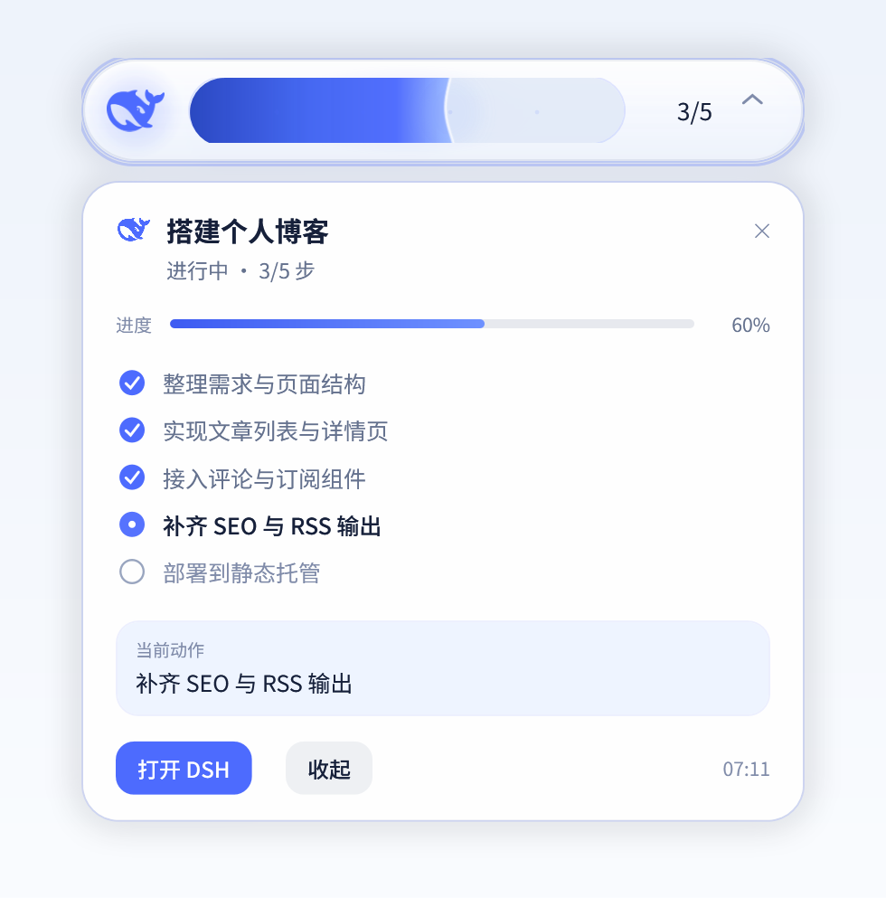

# DSH Task HUD · 小蓝鲸任务胶囊

给 [DeepSeek Harness](https://github.com/deepseek-ai) 加一颗「液体能量」任务胶囊：一颗浮在桌面最上层的悬浮窗，用官方小蓝鲸和一条会流动的蓝色液体，实时汇报当前会话的 todo 进度。

工作台最小化，或被全屏窗口完全盖住时，它出现在桌面上；切回工作台就自动收起。悬停看百分比，点一下展开任务卡，按住可以拖到任何位置。

<p>
  
  
</p>

> 截图里的任务与步骤都是示例数据，不包含任何真实会话内容。

## 功能

- **纯桌面悬浮**：没有页面内 HUD，不会插进工作台界面；只在桌面置顶窗里出现一颗胶囊。
- **液体即进度**：蓝色液体的液面位置 = 已完成步骤 / 总步骤；液面有波动、气泡和辉光，不是一根生硬的进度条。
- **只在需要时出现**：工作台被最小化（`IsIconic`），或前台是一块铺满整屏、且不属于 DSH 的窗口（全屏视频 / 游戏 / 远程桌面）时才显示；Alt+Tab 切普通窗口、打开截图工具都不会把它叫出来。
- **悬停看百分比**：鼠标停在胶囊上 150ms，`3/5` 原地淡换成 `60%`，移开 400ms 换回；不展开、不位移。
- **点击展开任务卡**：单击胶囊展开/收起任务卡——标题、状态、进度、步骤清单（✓ / ● / ○）、当前动作、耗时；点卡片外部也能收起。
- **拖动跟手**：按住胶囊可以拖到任意位置；拖拽位移用屏幕坐标差计算并按设备像素对齐，不会来回抖。位置记在 `~/.dsh/dsh-hud/overlay-pos.json`，下次启动原地恢复。
- **跟着系统明暗走**：读 Windows 个性化设置里的 `AppsUseLightTheme`，深色磨砂玻璃 / 浅色纸面白玻璃两套皮肤实时切换。
- **完成态**：液体满格 → 读数变对勾，停留 6.5 秒后淡回「待命」。
- **不被截图**：置顶窗声明了 `WDA_EXCLUDEFROMCAPTURE`，截图 / 录屏工具拍不到它，不会在截图里叠出一颗 HUD（Windows 10 2004+；更老的系统会退化成「黑块」式遮挡）。
- **字体**：HUD 用 `Noto Sans SC`，不再是系统默认的微软雅黑；没装 Noto 的机器会回退到系统 CJK 字体。
- **只读**：HUD 只读取 DSH 已经产生的 todo / turn 状态，不写入、不改动会话，也不联网。

## 安装

前置：DeepSeek Harness 桌面版（自带 `dsh` CLI，安装目录下 `resources/runtime/cli/bin/dsh.cmd`）、Windows 10/11（桌面置顶窗使用系统自带 PowerShell 5.1 + WPF，无第三方依赖）。插件只有 Windows 端实现：其他系统上宿主半仍会运行，但没有可显示的窗口。

### 方式一：目录安装（推荐）

```bash
git clone https://github.com/zoe1nan/dsh-hud.git
dsh plugin --profile desktop add /path/to/dsh-hud
```

### 方式二：打包安装

```bash
pnpm pack            # 或 npm pack，得到 dsh-hud-1.1.0.tgz
dsh plugin --profile desktop add /path/to/dsh-hud-1.1.0.tgz
```

安装后**重启 DeepSeek Harness**（桌面版重启才会加载新插件）。重启后把工作台最小化，胶囊就会出现在桌面上；第一次启动时置顶窗脚本需要一两秒准备。

## 使用

- 悬停胶囊：`3/5` ↔ `60%` 切换。
- 单击胶囊：展开 / 收起任务卡。
- 按住拖动：拖到任意位置，松手即记住（`overlay-pos.json`）。
- 任务完成后：满格 → 对勾 → 6.5 秒后回到「待命」。
- 进行中但还没写 todo 时：胶囊显示「进行中」，液体呼吸但不虚构百分比。
- 工作台恢复前台后：桌面胶囊自动隐藏，直到下次最小化或被全屏窗口盖住。

## 数据与隐私

- 所有数据都在本机：宿主把当前状态写到 `~/.dsh/dsh-hud/state.json`，置顶窗只读这个文件。
- 不联网、不上传、不写会话；插件目录里没有账号、密钥或本机路径。
- 可随时删除 `~/.dsh/dsh-hud/` 重置（不影响会话数据）。

## 工作原理

```
DSH sessions ──todos 投影 / turn 事件──▶ Host 半 (index.js)
                                          │  折叠成一份只读状态
                                          └──▶ ~/.dsh/dsh-hud/state.json ──▶ 桌面置顶窗 (overlay.ps1, WPF)
```

- **Host 半**（`index.js`）：注入 `sessions` / `sessionProjections`，用 `sessionProjections.snapshot()` 读 `todos` 与 `title`，用 `session/event` 折叠 turn 运行状态；输出 `status`（charging / waiting / done / noplan）、步骤数组、百分比与当前动作；按需拉起置顶窗进程，并用 15 秒心跳看门狗维持单实例。
- **桌面置顶窗**（`overlay.ps1`）：无边框、透明、Topmost 的 WPF 窗口；与宿主通过文件 IPC（状态、心跳、位置）协作；单实例 Mutex；`-ParentPid` 守护，宿主退出即退出；进程意外退出会被看门狗自动拉起。
- **形态交接**：置顶窗每 400ms 检查两个条件——工作台窗口是否 `IsIconic`（最小化），以及前台窗口是否是一块**铺满整块屏幕**且不属于 DSH 的窗口（全屏视频 / 游戏等）；满足任一才显示。
- **主题**：每 350ms 先按系统明暗切换调色板，再读状态，不依赖宿主下发。
- **不进截图**：显示时调用 `SetWindowDisplayAffinity(hwnd, WDA_EXCLUDEFROMCAPTURE)`；调试期可用环境变量 `DSH_HUD_ALLOW_CAPTURE=1` 或文件开关关闭（便于截图验收）。
- **拖拽**：按下时记录鼠标的屏幕物理像素坐标与窗口 Left/Top，移动时用屏幕坐标差 / DPI 得到 DIP 位移，并按整设备像素对齐，避免「窗口内坐标 → 窗口移动 → 相对坐标反向变化」形成的抖动反馈环。

## 目录结构

```
dsh-hud/
├── index.js            # Host 半：状态折叠 + 置顶窗拉起/看门狗
├── overlay.ps1         # Windows 桌面置顶窗（PowerShell 5.1 + WPF）
├── whale.png           # 官方小蓝鲸图标（透明 PNG）
├── whale.svg           # 官方鲸鱼矢量路径（来源：DSH 界面图标）
├── cordis.patch.yml    # 插件装配
├── package.json
└── docs/               # README 截图
```

## 开发与调试

- `node --check index.js` 做语法检查；`overlay.ps1` 用 PowerShell 解析器校验（脚本必须带 UTF-8 BOM，否则中文注释会让 Windows PowerShell 5.1 按 ANSI 解析而报错）：
  ```powershell
  $s = Get-Content -Raw overlay.ps1
  $e = $null; [System.Management.Automation.Language.Parser]::ParseInput($s, [ref]$null, [ref]$e) | Out-Null
  if ($e.Count) { $e | Select-Object -First 5 }
  ```
- 首次安装后如果桌面窗没出现，查看 `~/.dsh/dsh-hud/overlay-spawn.log` 与 `overlay.log`。
- 置顶窗被看门狗拉起时无法传环境变量，调试也可以在 `%USERPROFILE%\.dsh\dsh-hud\` 下新建空文件：`force-show`（强制显示）、`allow-capture`（允许被截图）、`snapshot`（标志存在期间每 1.2 秒把窗口自身渲染成 `overlay-snapshot.png`，用于检查真实排版；删掉文件即停止）；删掉文件即恢复。
- 置顶窗把窗口起点、尺寸直接按 DIP 写回 `overlay-pos.json`，拖动位置就存在这里。
- 同步到本地安装目录时注意：本地副本的 `package.json` 包名与 `cordis.patch.yml` 必须与安装方式一致（本文档仓库副本用 `dsh-hud`，本地 link 安装通常用 `@local/dsh-hud`）。

## 已知限制

- 桌面置顶窗目前只支持 Windows（PowerShell 5.1 + WPF 自绘，无第三方依赖）。
- 进度数据来自 DSH 的 `todo_write`；还没有写 todo 的轮次会显示「进行中」而不是虚构百分比。
- 超过 45 分钟没有新事件的会话不再参与显示（避免旧任务常驻）。
- 目前没有独立的设置页（尺寸/位置/开关后续可加；置顶窗位置可拖动保存）。
- 更新插件代码后需要重启 DeepSeek Harness 才会加载新版本。

## License

[MIT](LICENSE)

---

### English

A "liquid energy" task HUD plugin for DeepSeek Harness. A desktop-only, always-on-top capsule with the official whale floats over the desktop whenever the workbench is minimized or fully covered by another fullscreen window, and hides again when the workbench comes back. The liquid level is completed steps / total steps. Hover to swap `3/5` for `60%`; click to expand a task card with the step checklist, current action and elapsed time; drag it anywhere and the position is remembered. It follows the Windows light/dark setting, stays out of screenshots (`WDA_EXCLUDEFROMCAPTURE`), and keeps all state under `~/.dsh/dsh-hud/`. There is no in-page HUD.

Install with `dsh plugin --profile desktop add <path-or-tgz>` and restart DeepSeek Harness. Windows-only (PowerShell 5.1 + WPF, no third-party dependencies); strict read-only, no network.

MIT licensed.
